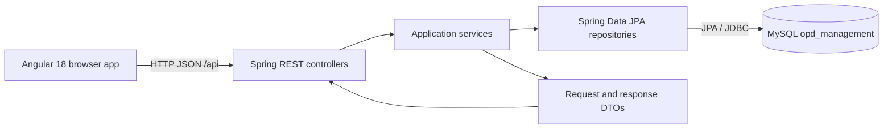
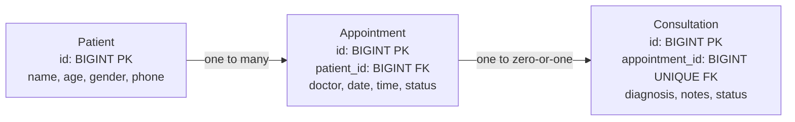

# OPDDesk

A small outpatient department management module for registering patients, booking appointments, and recording consultation summaries. It is designed as a straightforward internship project: a standalone Angular frontend calls a Spring Boot REST API, which stores the records in MySQL.

## Features

- Register patients and view/search the patient directory by name or phone number.
- Book appointments for existing patients using a patient dropdown.
- View all appointments or today's appointments with their status.
- Save one consultation per appointment, complete it, and view completed consultations for a patient.
- Validate requests, show simple API errors, and keep database credentials out of source control.

## Technology

| Area        | Technology                                                             |
| ----------- | ---------------------------------------------------------------------- |
| Backend     | Java 17, Spring Boot 3.3, Spring Web, Spring Data JPA, Bean Validation |
| Database    | MySQL 8, MySQL Connector/J                                             |
| Frontend    | Angular 18 standalone components, TypeScript, HTML, CSS, HttpClient    |
| Build tools | Maven 3.8+, Node.js 22+, npm                                           |

## Architecture

The application is split into two independently run processes. The browser UI sends JSON requests to the backend; Spring MVC routes requests through controllers and services to Spring Data repositories. JPA maps the three domain entities to MySQL tables.



### Backend Layers

- `controller`: REST routes, HTTP status codes, and request validation.
- `service`: business rules, record lookup, workflow changes, and DTO mapping.
- `repository`: Spring Data JPA queries and persistence operations.
- `entity`: the three database-backed domain records and their relationships.
- `dto`: JSON request/response records. The API does not serialize entities directly.
- `exception`: shared JSON responses for invalid requests, missing records, and conflicts.

There are no service interfaces or extra application layers; constructor injection is used throughout.

### Data Model

The system uses three tables. A patient may have multiple appointments; an appointment may have zero or one consultation. The consultation's unique appointment reference prevents duplicate consultation records.



API responses flatten patient and appointment details into DTO fields instead of serializing JPA relationships directly.

### Consultation Workflow

1. Book an appointment; its status starts as `BOOKED`.
2. Save a consultation for that appointment; it starts as `INCOMPLETE`.
3. Saving the same appointment's incomplete consultation updates its diagnosis and notes rather than creating a duplicate.
4. Mark it complete; the consultation becomes `COMPLETED` and the appointment becomes `COMPLETED`.
5. Completed consultations can be listed by patient ID. A completed consultation cannot be edited through the save endpoint.

## Project Layout

```text
.
|-- .env.example
|-- .gitignore
|-- backend/
|   |-- pom.xml
|   `-- src/main/
|       |-- java/com/example/opd/
|       |   |-- OpdApplication.java
|       |   |-- controller/
|       |   |-- dto/
|       |   |-- entity/
|       |   |-- exception/
|       |   |-- repository/
|       |   `-- service/
|       `-- resources/application.properties
|-- database/schema.sql
|-- frontend/
|   |-- package.json
|   `-- src/app/
|       |-- core/services/
|       |-- features/appointments/
|       |-- features/consultations/
|       |-- features/patients/
|       |-- app.component.*
|       `-- app.config.ts
`-- README.md
```

The local root `.env` is intentionally not listed: it is ignored by Git and should contain only your machine's database credentials.

## Setup

### Prerequisites

Install Java 17 or newer, Maven 3.8 or newer, Node.js 22 or newer with npm, and MySQL 8. The MySQL server must be running before the backend starts.

On Windows, if MySQL is installed as the `MySQL80` service, start it from an Administrator PowerShell terminal:

```powershell
Start-Service -Name MySQL80
Get-Service -Name MySQL80
```

### Configure MySQL

Create the database from the project root. Enter your MySQL password at the prompt:

```powershell
mysql -u root -p -e "CREATE DATABASE IF NOT EXISTS opd_management;"
```

Create your local environment file and edit its values:

```powershell
Copy-Item .env.example .env
notepad .env
```

Set `DB_USERNAME`, `DB_PASSWORD`, and optionally `DB_URL` in `.env`. For a local MySQL server, the defaults are:

```dotenv
DB_USERNAME=root
DB_PASSWORD=your_local_mysql_password
DB_URL=jdbc:mysql://localhost:3306/opd_management?createDatabaseIfNotExist=true&useSSL=false&allowPublicKeyRetrieval=true&serverTimezone=UTC
```

Do not commit `.env` or put a real password in `.env.example`. Spring Boot imports `../.env` when launched from the `backend` directory. Environment variables already set in the shell can also supply these values.

`database/schema.sql` creates the database. Hibernate creates and updates the three tables from the JPA entities on backend startup (`spring.jpa.hibernate.ddl-auto=update`).

## Run the Applications

Run each application in its own terminal. From the repository root, start the backend in terminal one:

```powershell
cd backend
mvn spring-boot:run
```

The API is available at `http://localhost:8080`. Build a runnable jar instead with `mvn package`, then run it from the `backend` directory using `java -jar target/opd-backend-0.0.1-SNAPSHOT.jar`.

Start the frontend in terminal two:

```powershell
cd frontend
npm install
npm start
```

Open `http://localhost:4200`. The Angular services call `http://localhost:8080/api`; the backend permits requests from the local Angular development origin `http://localhost:4200`.

## REST API

All endpoints use JSON except GET requests. Date fields use `YYYY-MM-DD`; appointment time uses 24-hour `HH:mm` format. IDs in request bodies refer to existing records.

### Patients

| Method | Endpoint                            | Description          | Success       |
| ------ | ----------------------------------- | -------------------- | ------------- |
| `POST` | `/api/patients`                     | Create patient       | `201 Created` |
| `GET`  | `/api/patients`                     | List all patients    | `200 OK`      |
| `GET`  | `/api/patients/search?keyword=asha` | Search name or phone | `200 OK`      |

Create patient request:

```json
{
  "name": "Asha Patel",
  "age": 29,
  "gender": "Female",
  "phone": "+1 555 010 1234"
}
```

Example response:

```json
{
  "id": 1,
  "name": "Asha Patel",
  "age": 29,
  "gender": "Female",
  "phone": "+1 555 010 1234"
}
```

Name, age, gender, and phone are required. Age must be between 1 and 120; phone must contain 7 to 20 digits or common phone punctuation.

### Appointments

| Method | Endpoint                  | Description                    | Success       |
| ------ | ------------------------- | ------------------------------ | ------------- |
| `POST` | `/api/appointments`       | Book for an existing patient   | `201 Created` |
| `GET`  | `/api/appointments`       | List all, ordered by date/time | `200 OK`      |
| `GET`  | `/api/appointments/today` | List appointments for today    | `200 OK`      |

Book appointment request:

```json
{
  "patientId": 1,
  "doctorName": "Dr. Mehta",
  "appointmentDate": "2026-10-10",
  "appointmentTime": "10:30"
}
```

The response includes `id`, `patientId`, `patientName`, `doctorName`, `appointmentDate`, `appointmentTime`, and `status` (`BOOKED` or `COMPLETED`).

### Consultations

| Method | Endpoint                                 | Description                                                    | Success                                           |
| ------ | ---------------------------------------- | -------------------------------------------------------------- | ------------------------------------------------- |
| `POST` | `/api/consultations`                     | Create or update an incomplete consultation for an appointment | `201 Created` when created; `200 OK` when updated |
| `PUT`  | `/api/consultations/{id}/complete`       | Complete the consultation and its appointment                  | `200 OK`                                          |
| `GET`  | `/api/consultations/patient/{patientId}` | List completed consultations for a patient                     | `200 OK`                                          |

Save consultation request:

```json
{
  "appointmentId": 1,
  "diagnosis": "Seasonal allergies",
  "notes": "Rest and return if symptoms worsen."
}
```

The response includes consultation ID/status and appointment/patient summary fields. `notes` may be empty. Saving for a completed consultation returns `409 Conflict`.

### Error Responses

- `400 Bad Request`: validation failure, malformed JSON, or invalid date/time.
- `404 Not Found`: referenced patient, appointment, or consultation does not exist.
- `409 Conflict`: attempt to change an already-completed consultation.

Errors are returned as small JSON objects with a `message` field, or field-name keys for validation errors.

## Frontend Structure

The standalone root component provides navigation among three feature components. Each feature has its own template and styles. The services in `frontend/src/app/core/services/` define the API types and make HttpClient requests:

- `PatientService`: patient listing, search, and registration.
- `AppointmentService`: appointment listing, today's list, and booking.
- `ConsultationService`: saving, completing, and patient history.

Template-driven forms provide required/range/pattern checks. Screens show loading, empty, success, and error states. No UI component library is required.

## Troubleshooting

- **Access denied for `root`:** make sure `DB_PASSWORD` in `.env` matches MySQL. Workbench does not normally reveal an existing saved password; reset it in MySQL if unknown, then update `.env`.
- **Connection refused:** verify the MySQL80 service is running and `DB_URL` points to the correct host and port.
- **Database missing:** create `opd_management` using the SQL command above, or run `database/schema.sql`.
- **Frontend cannot reach API:** start the backend and confirm it listens on port 8080. The default Angular origin is port 4200.
- **Port already in use:** stop the other process or configure a different server port before starting the app.
